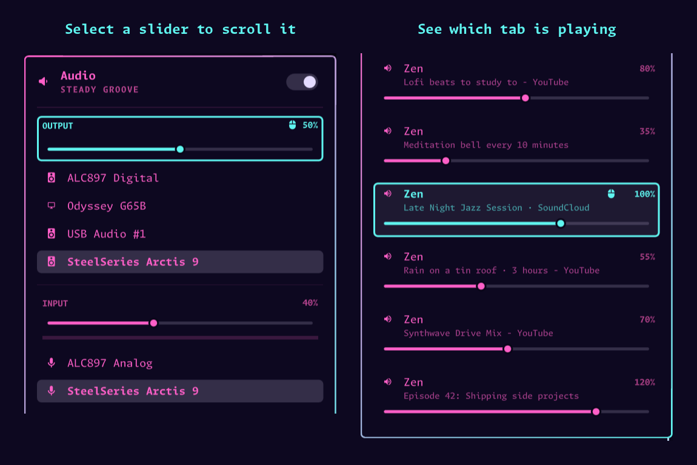

# Audio Focus

Omarchy's audio panel, with sliders that stay out of the way of your scroll wheel and browser streams you can tell apart.

<p align="center">
  
</p>

A drop-in replacement for the built-in `omarchy.audio` bar widget. Everything the stock panel does still works the same way: the volume slider, output and input pickers, the per-app mixer, mute, keyboard navigation and the bar icon's scroll-to-change-volume. It changes two things.

## Scroll the page, not the slider under the pointer

In the stock panel every slider grabs the mouse wheel. With a few apps playing, scrolling the panel stops dead whenever a slider passes under the pointer, and that app's volume moves instead.

Here the wheel scrolls the panel, always, until you choose a slider:

- **Select a slider** by clicking it, a stream's name, or the OUTPUT or INPUT label. It gets an outline, a 󰍽 mark beside its percentage, and its label, percentage and slider turn the selection colour. The wheel now moves that slider, anywhere on its row.
- **Unselect** by clicking the name or label again. Closing the panel clears the selection too.
- **Ctrl + wheel** moves any slider under the pointer without selecting it.
- A page scroll that carries the selected row under the pointer keeps scrolling the page. The wheel only moves the selected slider once the page has been still for about half a second.

The selection colour is the theme's accent. If the theme draws the bar text in its accent colour, so a highlight in that colour would not show, the panel picks the first colour from the theme's `colors.toml` that stands out (cyan, then blue, green and yellow).

## See which tab is playing

Zen names each tab's audio stream after the page title and keeps it current as you move between videos. That naming comes from Firefox's audio code, so other Firefox-based browsers should label their tabs the same way. The stock panel only shows the app name, so three tabs playing look like three identical "Zen" rows. Audio Focus shows the title under the app name.

Browsers that give every stream the same generic name (Chromium-based browsers use "Playback") show the app name alone, as before. Other generic names such as "AudioStream" are hidden the same way.

## Smaller changes

- The panel no longer rubber-bands past the top when you scroll up quickly. The bottom edge keeps its bounce.
- Touchpad scrolling on a selected slider moves one step per notch's worth of movement instead of one step per event, the way the bar icon already did. A sideways tilt of the wheel no longer lowers the volume.

## Install

```bash
omarchy plugin add https://github.com/0w3n-N/omarchy-audio-focus.git --enable --yes
```

Audio Focus declares itself a replacement for `omarchy.audio`: it takes the stock widget's place in the bar, and anything that opens the built-in audio panel, such as Super + Ctrl + A, opens this one.

Built and tested on Omarchy 4.5 (Hyprland 0.56). There are no other dependencies: it uses the same PipeWire services and Omarchy audio helpers as the stock widget.

## Update

```bash
omarchy plugin update io.github.0w3n-n.audio-focus --yes
```

## Remove

```bash
omarchy plugin remove io.github.0w3n-n.audio-focus --yes
```

The stock Audio widget returns to its place in the bar.

## Privacy and security

- No network access.
- Writes no files. It reads the current theme's `colors.toml` for the selection colour.
- Runs no commands of its own. Like the stock widget, it calls Omarchy's `omarchy-audio-sink-availability` and `omarchy-audio-output-sink` helpers.
- Page titles come from websites, so every label is drawn as plain text, never as rich text. A test checks every `Text` element for this.

## Development

The plugin itself needs no build step. The tests cover the pure helpers in `Model.js` and run static checks on the QML and translations:

```bash
node --test test/
```

Files:

| File | What it is |
| --- | --- |
| `Panel.qml` | The bar widget and panel, from Omarchy's `omarchy.audio` |
| `ArmableSlider.qml` | Omarchy's `PanelSlider` with the selectable wheel |
| `Model.js` | Stream labels, tab titles and the selection colour |
| `i18n/` | The panel's strings in Omarchy's 50 languages |

## Credits

Built on the Audio widget and `PanelSlider` from [Omarchy](https://github.com/omacom/omarchy), MIT licensed; the translations in `i18n/` are the Audio widget's strings from Omarchy's catalogs.

## License

MIT. See [LICENSE](LICENSE).
